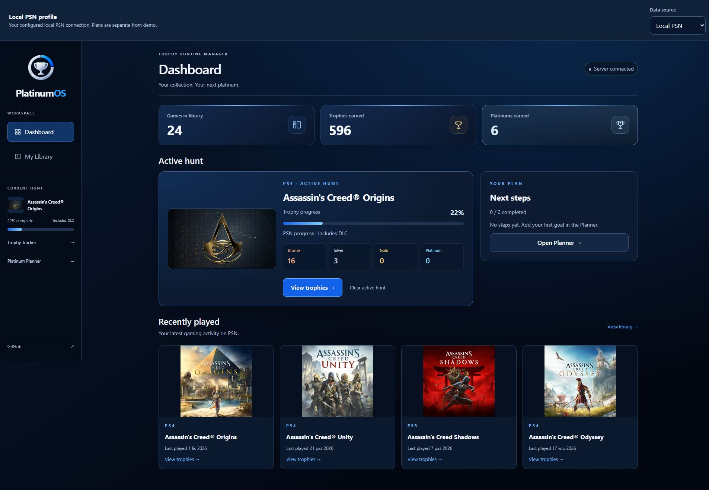
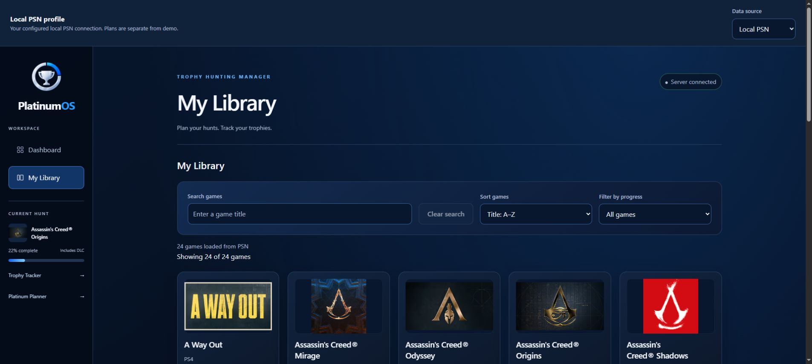
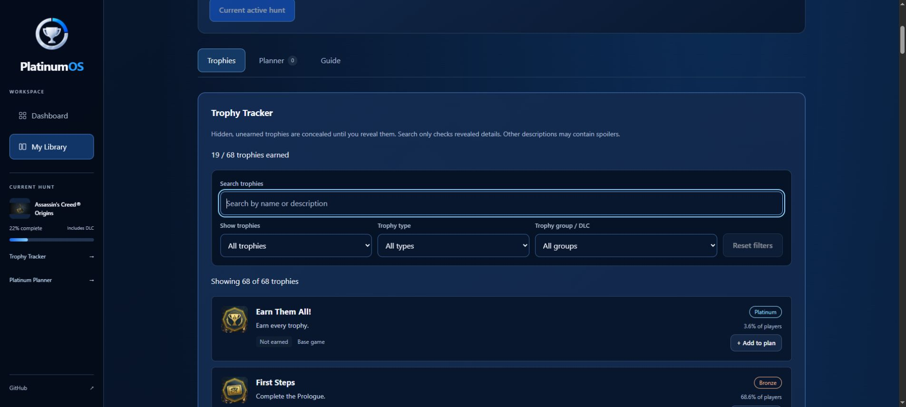

# PlatinumOS — Trophy Hunting Manager

Aplikacja do planowania platyn i śledzenia trofeów PlayStation. Buduję ją jako projekt portfolio, rozwijając umiejętności potrzebne do pracy jako Junior Frontend Developer.

**[Otwórz demo →](https://pinkcodesdev.github.io/PlatinumOS/)** — bez instalacji i logowania.

Demo zawiera fikcyjne gry i przykładowe trofea. Możesz sprawdzić wyszukiwanie, filtry, wybrać aktywną grę i ułożyć własny plan. Zmiany zapisują się w Twojej przeglądarce, a przycisk **Reset demo** przywraca profil startowy. Pełna wersja uruchamiana lokalnie pobiera dane z PSN.

## Skąd ten pomysł?

Podczas zdobywania platyny w Assassin’s Creed Unity musiałem drugi raz przechodzić misje co-op. Za pierwszym razem nie zebrałem wszystkich punktów synchronizacji potrzebnych do odblokowania umiejętności. Dopiero później zorientowałem się, że mogłem zrobić obie rzeczy przy jednym podejściu.

Chciałem mieć miejsce, w którym widzę brakujące trofea, zapisuję wskazówki i planuję kolejność działań. Stąd PlatinumOS — projekt oparty na problemie, z którym sam się spotkałem jako gracz.

## Jak wygląda pełna wersja

Poniższe screenshoty pochodzą z lokalnej wersji z danymi PSN. Publiczne demo korzysta z tych samych ekranów, ale pokazuje przykładowe gry i statystyki.

### Dashboard

Statystyki biblioteki, aktywna gra, postęp trofeów i ostatnio uruchamiane tytuły.



### My Library

Biblioteka z okładkami, wyszukiwaniem, sortowaniem i filtrowaniem postępu.



### Trophy Tracker

Lista trofeów, wymagania, rzadkość i filtry rodzaju oraz grupy DLC.



## Co już działa

- **Dashboard** — liczba gier, zdobytych trofeów i platyn, Active hunt, następne kroki planu oraz Recently played.
- **My Library** — wyszukiwanie po tytule, sortowanie, filtrowanie postępu, okładki i paski postępu.
- **Trophy Tracker** — opisy i ikony trofeów, status zdobycia, procent graczy, którzy zdobyli trofeum, wyszukiwanie oraz filtry statusu, rodzaju i DLC. Ukryte trofea można odsłonić świadomie.
- **Platinum Planner** — dodawanie własnych kroków lub trofeów, edycja, zmiana kolejności, odhaczanie i usuwanie. Każda gra ma osobny plan.
- **Wskazówki i poradniki** — własne Pro tips, dodawanie ich do planu i odnośniki do poradników PSNProfiles. Gdy brakuje przypisanego linku, aplikacja pozwala go wyszukać. Treść poradników nie jest automatycznie kopiowana.
- **Dwa źródła danych** — samodzielne demo oraz lokalna integracja z PSN. Zapisy obu profili są rozdzielone.
- **Responsywność i dostępność** — układ na telefon i desktop, etykiety formularzy, obsługa klawiatury, zarządzanie focusem i komunikaty o błędach z możliwością ponowienia.

## Stack

| Obszar           | Technologie                                                         |
| ---------------- | ------------------------------------------------------------------- |
| Frontend         | React, TypeScript, React Router, Vite                               |
| Wygląd           | CSS, bez frameworka UI                                              |
| Backend lokalny  | Node.js, natywne `node:http`, JavaScript w plikach `.mjs`           |
| Integracja       | `psn-api` — nieoficjalny klient PSN, endpointy HTTP zwracające JSON |
| Zapis planów     | `localStorage`                                                      |
| Testy            | Vitest, Testing Library, user-event, jsdom, Node.js test runner     |
| Kontrola jakości | ESLint, Prettier, TypeScript                                        |
| Publikacja       | GitHub Actions, GitHub Pages                                        |

## Jak jest zorganizowany kod

```text
src/
  pages/         strony Dashboard, Library i Game details
  components/    karty gier, Tracker, Planner i pozostałe elementy UI
  hooks/         logika planów i ich zapisu
  data/          adapter danych, profil demo, wskazówki i linki do poradników
  types.ts       wspólne typy danych
server/          lokalne API, autoryzacja PSN i serwisy danych
public/demo/     grafiki przykładowych gier i trofeów
docs/screenshots/ screenshoty pełnej wersji
```

Komponenty korzystają ze wspólnego adaptera danych. W trybie demo adapter zwraca lokalne dane, a w trybie PSN wywołuje backend. Dzięki temu oba tryby korzystają z tej samej logiki ekranów.

Backend obsługuje autoryzację, odświeżanie tokenów, stronicowanie odpowiedzi i cache. Dane uwierzytelniające pozostają po stronie serwera. Błędy dostawcy są zamieniane na kontrolowane odpowiedzi dla interfejsu.

## Uruchomienie lokalne

Wymagania: **Node.js 24** i **npm 11**.

```bash
git clone https://github.com/PinkCodesDev/PlatinumOS.git
cd PlatinumOS
npm ci
npm run dev
```

Otwórz adres wskazany przez Vite, domyślnie `http://localhost:5173/`. Demo nie potrzebuje backendu ani pliku `.env`. W PowerShell, jeśli system blokuje `npm.ps1`, użyj `npm.cmd` zamiast `npm`.

### Opcjonalnie: własne dane PSN

1. Skopiuj `.env.example` do `.env`, jeśli nie masz jeszcze tego pliku.
2. Ustaw lokalnie `PSN_NPSSO` zgodnie z [instrukcją uwierzytelniania psn-api](https://psn-api.achievements.app/authentication/authenticating-manually).
3. W drugim terminalu uruchom `npm run dev:server`.
4. W aplikacji wybierz **Data source → Local PSN**.

Backend nasłuchuje na `127.0.0.1:3001`, a Vite przekazuje do niego żądania `/api`. Po zmianie `.env` uruchom backend ponownie. NPSSO może z czasem wymagać wymiany. Nie umieszczaj go w kodzie frontendu ani w repozytorium; `.env` jest ignorowany przez Git.

## Sprawdzanie projektu

```bash
npm run check
```

To polecenie sprawdza formatowanie, lint, testy frontendu i backendu oraz wykonuje build z kontrolą typów.

Testy obejmują m.in. filtry i wyszukiwanie trofeów, ukrywanie spoilerów, ponawianie pobierania, edycję i zapis planów, przełączanie profili oraz reset demo. Po stronie backendu sprawdzają autoryzację, cache, stronicowanie i obsługę błędów. Korzystają ze sztucznych danych i nie wymagają konta PSN.

Osobno można uruchomić `npm run test:frontend`, `npm run test:server` lub `npm run test:watch`. Testy w jsdom sprawdzają zachowanie komponentów; wygląd i działanie na urządzeniach wymagają również sprawdzenia w przeglądarce.

## Publikacja i obecne ograniczenia

Push na `main` uruchamia kontrole i publikację frontendu na GitHub Pages. Wersja publikowana używa adresów z `#`, żeby odświeżenie podstrony działało na statycznym hostingu.

- Publiczna strona działa wyłącznie na danych demo. Integracja PSN jest lokalna, dla jednego skonfigurowanego konta.
- Biblioteka PSN obejmuje tytuły powiązane z trofeami, a nie pełną listę zakupów.
- Postęp pobrany z PSN może uwzględniać DLC — nie oznacza dokładnego postępu do samej platyny.
- Plany i wskazówki są zapisane w danej przeglądarce. Nie synchronizują się między urządzeniami; wyczyszczenie danych przeglądarki usuwa zapisy.
- Odznaczenie kroku w Plannerze nie zmienia statusu trofeum w PSN.
- Projekt nie jest powiązany z Sony ani PSNProfiles. Nazwy gier i materiały graficzne widoczne na screenshotach należą do ich właścicieli.

## Czego uczę się przy tym projekcie

Łączę naukę Reacta i TypeScriptu z budowaniem aplikacji, której sam chciałbym używać. Pracuję nad stanem komponentów, przetwarzaniem danych, komunikacją z API, routingiem, dostępnością i testami.

Korzystam z AI jako wsparcia w implementacji, debugowaniu i nauce. Projekt rozwijam etapami: sprawdzam działanie zmian i wracam do kodu, żeby rozumieć jego logikę oraz decyzje techniczne.

Następne kierunki rozwoju to dopracowanie scenariuszy użytkownika i testów end-to-end, a w dalszej kolejności konta użytkowników i synchronizacja planów. Baza danych oraz publiczna obsługa wielu kont PSN nie są jeszcze zaimplementowane.
